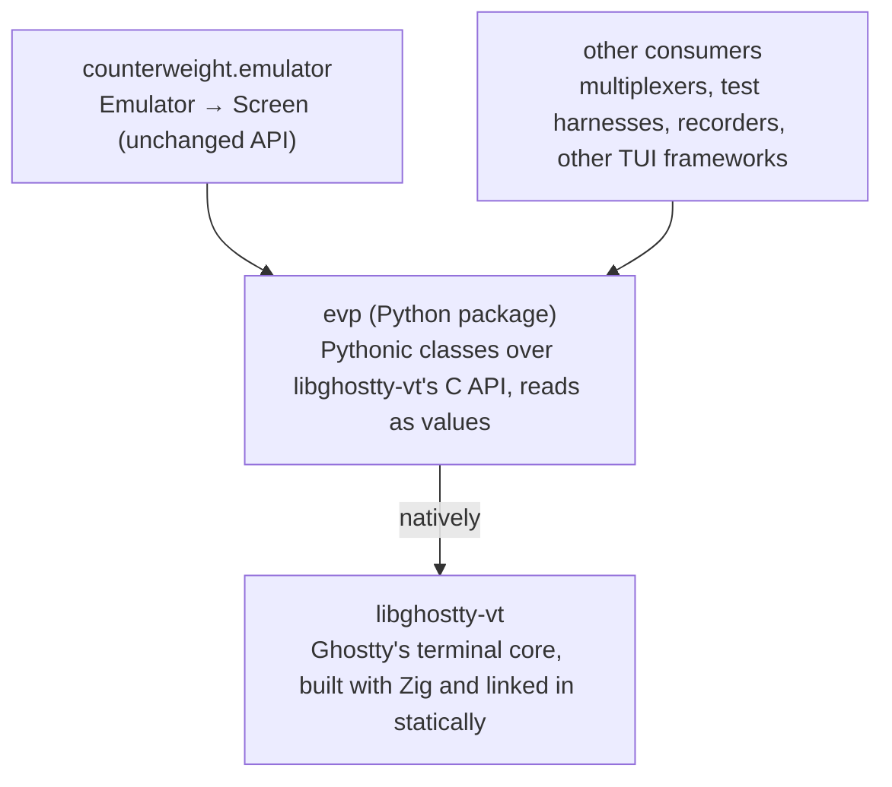

# Plan: evp, an Owned Binding to libghostty-vt

Artifact: https://claude.ai/code/artifact/ec9acde5-2420-4684-8f2e-1ed974a51fc2

This plan builds evp, a Python binding to libghostty-vt, Ghostty's terminal emulator library,
to replace [pyghostty](https://github.com/AnswerDotAI/pyghostty) as [counterweight](https://github.com/JoshKarpel/counterweight)'s binding to it,
as [waxy](https://github.com/JoshKarpel/waxy) is counterweight's binding to taffy.
It covers why, what the binding's API returns, which language it's written in, how it's built and released,
and how `counterweight.emulator` moves onto it.
It doesn't change counterweight's `Emulator` or `Screen`, the API the rest of counterweight and its users see,
and it doesn't move counterweight onto the kitty keyboard protocol or anything else its emulator doesn't do today,
though evp's first release binds more of libghostty-vt than counterweight uses.
The name is a pun: EVP, electronic voice phenomena,
are the voices ghost hunters claim to record, and evp is how Python hears from Ghostty.
counterweight's copy of this plan is [plans/ghostty-binding.md](https://github.com/JoshKarpel/counterweight/blob/43ad2e1477994716b3254626f245af42407944f4/plans/ghostty-binding.md).

## Why own the binding?

Every cost below comes from the binding, not from libghostty-vt,
and fixing pyghostty upstream would cure only the first.

- **Making the first emulator takes about 190 ms.**
  pyghostty is cffi in in-line ABI mode: importing `pyghostty._ffi` parses its 3,500-line cdef with pycparser (about 94 ms),
  and each type string `Emulator.__init__` passes to `ffi.new` is parsed again on first use,
  after a `typedef` line for every typedef in the cdef (about 4 ms each, about 95 ms for its twenty).
  An inline app makes its emulator before its first frame, so every inline app starts that much later
  (see Run 29 in [counterweight's performance analysis](https://github.com/JoshKarpel/counterweight/blob/43ad2e1477994716b3254626f245af42407944f4/plans/performance-analysis.md)),
  and every test subprocess that imports the emulator pays it too.
  The same cdef built out-of-line imports, loads the library and makes those types in 0.8 ms.
  Since the cost is architectural, an inline app keeps making its emulator unconditionally:
  once the binding loads in a millisecond or two, keeping it costs nothing worth an option.
- **Snapshots read cells through several cffi calls each.**
  `convert_row` reads a row's raw 64-bit cell values in one call, but reads a cell it hasn't seen
  through the cell iterator, since libghostty's header says the raw values' bit positions aren't ABI-stable,
  so they can't be decoded in Python.
  A screen that scrolls marks every row dirty, so a scroll converts the whole screen.
  Best times per snapshot of a 120×40 screen (counterweight's `benchmarks snapshot`):

  | After | µs per snapshot |
  | --- | --- |
  | nothing | 66 |
  | a progress bar rewriting its row | 76 |
  | a plain line, scrolling | 435 |
  | a line of wide characters, scrolling | 515 |
  | a line with every word colored, scrolling | 3,638 |

- **Scrollback is captured in rounds to keep it affordable.**
  Capturing all 10,000 scrollback rows each snapshot cost 17 to 24 ms,
  so `update` asks for about as many rows as scrolled, doubling until it finds the last row it already has.
  That search, and the cache of rows it keeps by id, is a large share of counterweight's `emulator.py`.
- **Raw pointers are counterweight's to get right.**
  A review found `convert_row` reading grapheme clusters into a fixed 32-slot buffer that libghostty overran:
  printing an `e` with 200 combining accents segfaulted the app.
  The buffer grows now, but nothing stops the next mistake of that kind.
- **counterweight reaches into pyghostty's internals.**
  It imports `pyghostty._ffi`'s `ffi`, `lib` and `check`, reads `Terminal._t` (with `# noqa: SLF001`),
  and makes 18 libghostty-vt calls itself; from pyghostty's public API it uses only `Terminal` and `init_sized`.
  So counterweight already is most of a binding, and depends on pyghostty for a built library and a cdef,
  through names pyghostty doesn't promise to keep.
  pyghostty has no type stubs, so none of those calls are type-checked.

## How does the web do it?

The web's embedded terminal is [xterm.js](https://xtermjs.org/), and its buffer API reads a cell at a time:
`buffer.getLine(y)` returns a line, `line.getCell(x, cell)` fills a cell object the caller passes back in
"to avoid costly recreation", and the cell has accessors like `getFgColorMode()` and `isFgRGB()`.
`translateToString()` reads a line's text in one call.

Python's own precedent is [pyte](https://github.com/selectel/pyte), and it reads values:
`screen.display` is each row's text, `screen.buffer[y][x]` is a `Char` named tuple of a cell's text, colors and attributes,
and `screen.dirty` is the set of rows that changed.

A JavaScript engine inlines xterm.js's small calls, so reading cell by cell is cheap there.
A call from Python into native code costs far more than the work it does,
so evp's reads return values, as pyte's do, and read the whole screen in one call.
Reading it a cell at a time is slower than that even for code that visits every cell
(see [Why no iterators?](#why-no-iterators)), so evp has no cell-at-a-time read.

## The binding's API



evp is a general Python API to libghostty-vt, and counterweight's `Emulator` is one consumer of it.
It has two layers, as waxy does.

- **The low-level layer mirrors the C API's objects**, as waxy's `TaffyTree` mirrors taffy's:
  one Python class for each of libghostty-vt's objects (a terminal, a render state, a key encoder),
  a method for each of its functions, enums for its constants, exceptions for its error codes,
  callbacks as Python callables, and reads that return immutable values.
- **Where the C API iterates, evp reads in bulk instead**, as waxy's `absolute_layouts(root)`
  returns every visible node with its absolute position, where Python would walk `children` and `layout` node by node.
  The bulk read is the only way to get what the iterators would have:
  a loop that crosses from Python into Rust once per item is slower than one call that returns every item,
  even for a caller that visits every item, so mirroring the iterators would add a slower way to do the same thing.
  A caller that wants one item (the cell under the mouse) is the exception, which a point lookup serves.

```python
terminal = Terminal(columns=120, rows=40, max_scrollback_bytes=10_000_000, on_write_pty=pty.write)
terminal.feed(output)
terminal.resize(columns=100, rows=30)

state = RenderState(terminal)

# Every row, each changed one read in one native call, as values.
frame = state.frame()  # the cursor, colors, styles added since the last frame, and the rows
for row in frame.rows:  # a row unchanged since the last frame is the same object
    row.graphemes, row.widths, row.styles

keys = KeyEncoder(terminal)  # encodes as the terminal's modes say
pty.write(keys.encode(Key.ENTER, mods=Mods.CTRL))
```

The first release covers what embedding a terminal needs:

| Area | libghostty-vt | Low level | Bulk reads |
| --- | --- | --- | --- |
| The terminal | `terminal.h`, `modes.h`, `device.h`: write, resize, reset, scroll the viewport, options and callbacks (replies to the program, the bell, title, working directory, clipboard writes, and the size, color scheme and device attributes it reports) | `Terminal`, `DeviceAttributes` | |
| Reading the screen | `render.h`, `screen.h`, `style.h`, `color.h`: render state, dirty rows, cells, styles, the palette, grid references into the scrollback | `RenderState`, `Style`, `Color` | `RenderState.frame()`, `RenderState.scrolled_off()`, `RenderState.history()` |
| Input to the program | `key/`, `mouse/`, `focus.h`, `paste.h`, `size_report.h`, `modes.h`, `color_scheme.h` encoders | `KeyEncoder`, `MouseEncoder`, `encode_focus`, `encode_paste`, ... | |
| Text out | `formatter.h`: the terminal's contents as plain text or VT | `Formatter` | |
| Widths | `unicode.h`: a codepoint's and a grapheme's width, as libghostty measures them | `codepoint_width`, `grapheme_width` | |

libghostty-vt 0.2.2 has no callback for sequences the terminal doesn't recognize.
Its callbacks for the replies to ENQ and XTVERSION tie the reply's string to the terminal's lifetime,
so a Python callable can't supply one, and evp leaves them unset:
Ghostty then sends nothing for ENQ and "libghostty" for XTVERSION.
Enums are Python `IntEnum`s and `IntFlag`s (`Key`, `Mods`, `MouseButton`), built from libghostty's C constants.

Later releases cover the rest, each of which has its own object lifetimes and callbacks to design,
so each waits for its own design rather than a mirror rushed into the first release:
a point lookup for one cell (`screen.h`'s grid references), for a consumer that reads a cell the bulk reads don't,
like its hyperlink, selection and its gestures (`selection.h`), search (`search.h`), tracked grid references (`grid_ref_tracked.h`),
saving and restoring a terminal (`snapshot.h`), the standalone OSC and SGR parsers,
and kitty graphics (`kitty_graphics.h`), which counterweight's [#441](https://github.com/JoshKarpel/counterweight/issues/441) wants.

**The screen helpers are what replaces `emulator.py`'s cffi loops:**

- **`frame()` returns `Row` values, and an unchanged row is the same object.**
  evp keeps the last frame's rows, and hands back the same `Row` for a row that shows the same cells,
  so a consumer that keeps derived data by row (`Emulator` shares unchanged rows by identity) skips them for free.
  A row libghostty doesn't mark dirty is unchanged at the same position.
  The dirty flag alone can't say more, since a scroll marks every row dirty,
  and the scroll is the case this plan exists to make fast.
  So `frame()` reads a dirty row's raw cells and looks for a row of the last frame with the same ones,
  which finds every row a scroll moved, scroll regions included,
  and a comparison usually stops at the first cell, so trying every row is cheap.
  Equal raw cells aren't enough on their own, and the tests reproduce both of these:
  libghostty reuses a freed style id within a page, so `frame()` reads each of the row's style ids' styles again,
  and a cell's codepoints after its first live outside its raw value,
  so a row holding a multi-codepoint grapheme cluster is always read again.
  libghostty-vt 0.2.2 reads raw cells only one at a time;
  [plans/upgrade-libghostty-vt.md](plans/upgrade-libghostty-vt.md) covers the release that reads a row's in one call.
- **A row's cells come back as parallel sequences**, its grapheme clusters as `str`s, their widths, and their style indices,
  one entry per column, so a row of 120 cells is a handful of objects, not 120.
  A wide character's second column is an empty grapheme of width 0.
- **Styles are indices into the terminal's style table**, with each frame and each `scrolled_off()` result
  carrying the styles added since the last of either, so a style always arrives no later than the first row that uses it.
  libghostty's style ids mean something only within a page, so the helper interns styles itself, terminal-wide,
  and a consumer converts each style once, by index.
- **`scrolled_off()` returns the rows that scrolled into the scrollback since the last call**, read natively,
  so the doubling search `emulator.py` does to keep capturing affordable goes away.
  It keeps a tracked grid reference on the row at the top of the screen at its last call,
  which follows that row into the scrollback, so its position there counts the rows that scrolled off since,
  and reads those rows through grid references.
  Its result's `has_gap` is true when rows may have been lost since the last call:
  the scrollback freed the anchor's row to make room, the program cleared the scrollback (`ESC[3J`),
  or a resize rewrapped it.
  A consumer keeping its own history then knows to mark the gap or rebuild.
  It's a flag, not an exception, because a gap is the program's doing, not a mistake by evp's caller.
  On 0.2.2 an erase is caught only when the last call found rows in the scrollback,
  since after an erase the anchor lands back at the top of the screen.
  `history()` reads the whole scrollback the same way, for a consumer that looks now and then.
- **A terminal has at most one `RenderState`.**
  libghostty lets a second render state take the first's dirty flags,
  which would make `frame()` hand back cached rows whose content changed.
  So making a second `RenderState` for a terminal raises while the first is alive:
  that's a mistake by the caller, so evp refuses it rather than documenting it.

**What stays in counterweight** is what depends on counterweight: matching libghostty's columns to counterweight's own
`grapheme_width` (see "The screen painter" in [canvas-and-embedding](https://github.com/JoshKarpel/counterweight/blob/43ad2e1477994716b3254626f245af42407944f4/plans/canvas-and-embedding.md)),
colors as `Color` and `IndexedColor`, and the swapped colors of inverse and invisible cells.
It runs once per changed row, as now.
Whether counterweight's `input_encoding` gives way to evp's encoders is a separate decision, after this plan:
its pure functions are tested and work, and swapping them changes nothing this plan fixes.

### Why no iterators?

A call from Python into Rust costs about 43 ns, loop included, before it does anything,
and a screen is thousands of cells, so the crossings alone outweigh reading the whole screen natively.
A throwaway prototype measured it on a release build, on a 120×40 screen with every row changed
(two screens alternating, so `frame()` reused no row), on Python 3.15 on a 2-core VM.
Each read touches every cell's grapheme and style.
The per-cell prototype reads a cell's grapheme and style in one call, through a grid reference,
where an iterator takes at least three (advance, grapheme, style), so it flatters reading a cell at a time.
Best µs per read of the whole screen:

| Read | Plain text | Every word colored |
| --- | --- | --- |
| `frame()` alone | 167 | 211 |
| `frame()`, then a Python loop over every cell | 434 | 482 |
| one call per cell, returning its grapheme and `Style` | 864 | 863 |
| one call per cell that does nothing | 208 | 208 |

Calls that do nothing take longer than `frame()` reading every cell,
and reading a cell at a time takes about twice as long as `frame()` and a Python loop over its rows.
The table is the worst case for `frame()`, which in use skips the rows that didn't change,
and the best case for iterating, which would take at least three calls a cell where the prototype takes one.
Reading one cell inverts it: a call reads one in 0.21 µs, where `frame()` takes 3.0 µs with nothing changed
and 4.2 µs after a row changes, which is why the exception is a point lookup and not an iterator.

## Which language?

The binding is native code either way; the question is what it's written in and what it builds Ghostty with.
Ghostty's `main` needs Zig 0.17.0 (`minimum_zig_version` in its `build.zig.zon`), and Ghostty checks the version at build time,
so whichever is chosen builds Ghostty with exactly the Zig its Ghostty commit names.

| | Rust: PyO3 and maturin | Zig: [ziggy-pydust](https://github.com/spiraldb/ziggy-pydust) | C helper: cffi API mode |
| --- | --- | --- | --- |
| Talks to Ghostty through | the C API, via [libghostty-rs](https://github.com/Uzaaft/libghostty-rs) | Ghostty's exported Zig modules (`vt`, `vt_c`), or its C API | the C API |
| Builds Ghostty | libghostty-rs's `build.rs`, at a pinned commit, statically | Ghostty as a Zig dependency, in the same build | Zig, separately, then links |
| Toolchains | Rust and Zig | Zig | a C compiler and Zig |
| Python packaging | maturin, as waxy | pydust's own, built around Poetry | setuptools |
| Precedent | waxy: its build, release workflow, stubs and habits | none | none |
| Status | PyO3 is widely used; libghostty-rs has had 5 releases since March 2026 (0.2.2 in September), about 178,000 downloads, and two main contributors | 0.26.0 in September 2025, the last commit not from a bot in February 2026; supports Zig 0.14 (README) or 0.15 (`pyproject.toml` on `main`) | cffi is mature; the helper is ours to write |

**ziggy-pydust is the closest fit in principle.**
It shares Ghostty's language, so evp could import Ghostty's Zig API directly, with no C ABI between them and no bindgen,
and needs one toolchain instead of two.
Ghostty exports those modules for downstream use (`src/build/GhosttyZig.zig`), and supports being built as a dependency.

**Today it doesn't fit, because of Zig's version.**
Zig doesn't keep source compatibility between minor releases, Ghostty's `main` needs 0.17, and pydust supports 0.15 at newest,
with its last release a year old.
Building the two in one Zig build means porting pydust to 0.17 first, and keeping it ported as Ghostty moves on:
in practice, maintaining a fork of pydust as well as evp.
Building Ghostty separately with 0.17 and pydust with 0.15 works over the C ABI, but gives up the Zig API, which was the reason to choose it.
Ghostty's Zig API is also less stable than its C API, which Ghostty checks against an ABI type manifest (`test-lib-vt-schema`),
so binding to it would tie evp to Ghostty's internal churn.

**Recommendation: Rust, on libghostty-rs's `libghostty-vt` crate.**
It's waxy's toolchain and release flow, and most of what a general binding needs already exists in Rust:

| libghostty-rs | What it is | Lines |
| --- | --- | --- |
| `libghostty-vt` | A safe Rust API over every area of the C API, its ownership and lifetimes worked out, encapsulating 593 uses of `unsafe`, with 117 unit tests and integration tests of lifetimes and allocators | 19,690 |
| `libghostty-vt-sys` | `build.rs`: clone Ghostty at a pinned commit, `zig build`, pkg-config, Windows and Apple specifics | 582 |
| | the bindgen script, and the bindings it generates | 181, 5,712 |

The build logic alone wouldn't be worth a dependency; evp could carry its own in about 800 lines.
The safe API is what's worth it: evp's low layer becomes PyO3 classes over safe Rust types,
with no `unsafe` of its own beyond direct calls into `libghostty-vt-sys` for what the safe API doesn't wrap yet
(in 0.2.2, `size_report.h`'s encoder, which the first release lists),
so raw pointer mistakes like `convert_row`'s overrun can't happen outside those calls,
and a fast helper's loop runs over the same safe types, at native speed.
evp builds on its newest release, 0.2.2, rather than a git pin of `master`,
so its first release needn't wait for libghostty-rs's next one.
0.2.2 lacks some of what the screen helpers would rather build on (a row's raw cells in one call, row ids,
overscan, a scrollback limit in lines), and evp works around each:
[plans/upgrade-libghostty-vt.md](plans/upgrade-libghostty-vt.md) lists them, what they cost, and what upgrading gains.
What this costs: two toolchains to build evp (Rust and Zig),
dependence on libghostty-rs's cadence for new Ghostty commits and for wrapping new C APIs
(or overriding its source with `GHOSTTY_SOURCE_DIR`, and calling `libghostty-vt-sys` directly for what isn't wrapped yet),
and an `sdist` that needs network access, since its `build.rs` clones Ghostty.
Revisit pydust if it supports Ghostty's Zig version; evp's Python API wouldn't change.

## How is it built and released?

- **Wheels** for manylinux (x86_64, aarch64), macOS (arm64) and Windows (x86_64),
  from `PyO3/maturin-action`.
  waxy builds only on each runner's native architecture (x86_64 Linux and Windows, arm64 macOS),
  so aarch64 Linux is a target waxy doesn't have.
  Each needs Ghostty built for that target.
  x86_64 macOS has no wheel: its runner is the most expensive and the slowest to build on, for few users,
  so pip builds evp from the sdist there.
  `libghostty-vt-sys` cross-compiles: maturin with `--zig` builds an aarch64 Linux wheel on an x86_64 host,
  tagged `manylinux_2_17`, in about 3 minutes 50 seconds cold (on the first spike's newer Ghostty).
  But a cross-built wheel can't be tested where it's built, and GitHub has a native runner for every target
  (`ubuntu-24.04-arm`), so each target builds and tests on its own runner,
  and cross-compiling is the way out if a runner goes away.
  arm64 macOS builds on `macos-15` rather than `macos-latest`,
  since on the macOS 26 image Zig 0.15.2 can't link its own build runner against libSystem.
  counterweight runs only on Linux and macOS (it uses `pty` and `termios`), but evp only feeds bytes
  and reads the screen, so it's useful on Windows too, as waxy is.
  libghostty-rs builds and tests `libghostty-vt` for Windows x86_64 (MSVC and GNU) in CI on every push to `master`,
  so Windows costs one more build target. Windows on ARM waits until libghostty-rs tests it.
- **One wheel per platform, through the limited API.**
  PyO3's `abi3` feature builds one wheel for every Python from the oldest it names;
  waxy instead builds one per Python version.
  Built with `abi3`, `frame()` takes 4 to 18% longer (at most 6 µs a frame),
  and the counterweight prototype 1 to 13% longer, since its own Python work dominates.
  That buys one wheel per platform instead of three, and wheels for Pythons not yet released.
  What it costs: those microseconds, and no wheel for free-threaded CPython, which can't load an `abi3` wheel.
- **Zig wherever evp is built**, from mise, pinned in `mise.toml`,
  at the version the Ghostty commit pinned by libghostty-rs requires.
  That's 0.15.2 for `libghostty-vt` 0.2.2, the newest release (its Ghostty is `a887df42`),
  and 0.17.0 for libghostty-rs's `master`, so a libghostty-rs bump can bring a Zig bump with it.
  `libghostty-vt-sys` runs `zig` from `PATH` unless its `ZIG` variable names another.
  evp has no Zig of its own and no Ghostty build logic, but `libghostty-vt-sys` has no prebuilt library:
  its `build.rs` clones Ghostty at its pinned commit and runs `zig build` (or builds a local checkout named by `GHOSTTY_SOURCE_DIR`).
  Its opt-in `pkg-config` feature links an installed libghostty-vt instead, which a wheel can't rely on.
  So Zig is needed by the CI that builds wheels and by whoever works on evp,
  not by anyone who installs a wheel, and not by counterweight's contributors.
- **Pinned and locked**: `Cargo.lock` pins libghostty-rs, whose `build.rs` pins Ghostty's commit,
  and the usual cooldown applies to both.
- **Type stubs** ship with the package, checked against the module, as waxy's are.

## What does the repository need?

The same scaffolding as [waxy](https://github.com/JoshKarpel/waxy), copied and then adjusted for Zig and Ghostty.
What evp adds is mostly Zig on every runner that compiles, and a cache for Ghostty's build.

- **Every tool comes from `mise.toml`**, locally and in CI alike: Rust (with clippy and rustfmt), Zig, just and uv,
  with Python's dev tools (ruff, mypy, maturin, pre-commit) in uv's dev group.
  Every workflow job that runs a tool installs them with [`jdx/mise-action`](https://github.com/jdx/mise-action),
  with mise itself pinned by the action's `version` input,
  so CI runs the versions a contributor runs, and a version bump is one reviewable change to `mise.toml`.
  That's a departure from waxy, whose CI installs Rust, just and uv with separate actions.
- **CI** (`.github/workflows/ci.yml`): on pushes to `main`, pull requests, and by hand.
  A matrix of Linux, macOS and Windows by each supported Python
  runs `just fix` (pre-commit over every file) and `just test` (mypy, pytest, and `cargo test`, with `-D warnings`),
  and caches Cargo's target directory, since every cell otherwise builds Ghostty from a clean clone.
- **Build** (`.github/workflows/build.yml`): on pushes to `main`, pull requests, by hand, and when `release.yml` calls it,
  builds an `abi3` wheel per platform with `PyO3/maturin-action`, tests it against each supported Python, and builds an sdist.
  On macOS and Windows maturin-action builds on the runner, so `mise-action` ahead of it puts Zig on `PATH`;
  on Linux it builds in a container, which needs mise of its own (see below).
  It runs alongside CI rather than inside it, and without CI's cache,
  so a release publishes exactly the build every pull request already ran, and nothing another run cached reaches a wheel.
  What that costs: a cold Ghostty build on every runner, every push:
  building the release wheel takes about 4 minutes on Linux, and 2 on Windows.
- **Release** (`.github/workflows/release.yml`): on a published GitHub release,
  calls `build.yml`, then publishes its wheels and sdist with `pypa/gh-action-pypi-publish` through
  [trusted publishing](https://docs.pypi.org/trusted-publishers/):
  only the publish job grants `id-token: write`, it runs in a `pypi` environment, and no API token exists.
  PyPI has a pending publisher for `evp` (this repository, `release.yml`, the `pypi` environment).
  A pending publisher doesn't reserve the name: if anyone else uploads `evp` first, PyPI discards it,
  so the name is unclaimed until evp's first release.
- **Linux wheels build in maturin-action's manylinux container**, unlike waxy's.
  maturin-action (v1) builds on the runner itself unless it's given `manylinux`, `container`, or a cross `target`,
  and waxy gives none, so its Linux wheels are tagged `manylinux_2_34`: they need glibc 2.34 or newer.
  With `manylinux: auto`, maturin-action builds in `quay.io/pypa/manylinux2014_x86_64`,
  and a spike wheel on `libghostty-vt` 0.2.2 built there is tagged `manylinux_2_12`
  (its newest glibc symbol is `GLIBC_2.10`), against `manylinux_2_34` for the same crate built on an Ubuntu 24.04 host.
  Ghostty's own code needs no newer glibc, so the container is what decides how old a Linux evp installs on.
  What that costs: Zig has to be installed inside the container, since only the runner's workspace is mounted,
  and maturin-action forwards only variables with prefixes like `CARGO_`, `RUST` and `PYO3_`, so `ZIG` doesn't reach it.
  `before-script-linux` runs in the same shell as `maturin build`, so it installs mise and runs `mise install` from the repository's `mise.toml`:

  ```bash
  curl -fsSL https://mise.run | MISE_VERSION=v2026.10.12 MISE_INSTALL_MUSL=1 sh
  export PATH="$HOME/.local/share/mise/shims:$HOME/.local/bin:$PATH"
  mise trust
  mise install
  ```

  `MISE_INSTALL_MUSL=1` matters: mise's default Linux build needs glibc 2.18, and `manylinux2014` has 2.17.
  `MISE_VERSION` pins mise itself, which the installer otherwise takes from whatever was released last, outside any cooldown.
- **Docs** (`.github/workflows/docs.yml`): builds the extension and an mkdocs site with `--strict`,
  as waxy's does (a home page, the API reference from the stub's docstrings, a changelog, and maintaining notes),
  and deploys it to GitHub Pages on pushes to `main`.
- **Dependabot** for GitHub Actions, weekly.
- **pre-commit**: `pre-commit-hooks`, `check-jsonschema`'s workflow and Dependabot checks,
  `just --fmt`, and `just fix`'s formatters and linters (ruff, `cargo fmt`, clippy).
- **A justfile** with waxy's recipes, grouped by Python and Rust, including its exports of
  `PYO3_ENVIRONMENT_SIGNATURE` and `PYO3_PYTHON`, which keep maturin and plain `cargo`
  from invalidating each other's builds: with Ghostty in the dependency tree, a spurious rebuild costs far more than it does in waxy.

## Why its own repository?

evp lives here, as waxy lives apart from counterweight, released on its own schedule,
so counterweight's contributors and CI stay pure Python: nothing they run builds Rust or Ghostty.
What that costs: a counterweight change that needs a new libghostty-vt feature is two pull requests,
one here and one there, with a release of evp between them.

## Work

Steps 1 to 3 happen in this repository; steps 4 and 5 in counterweight.

1. **Spike** (done; see [What did the spike find?](#what-did-the-spike-find)):
   a PyO3 module on `libghostty-vt` with `Terminal`, `RenderState.frame()`, `scrolled_off()` and `history()`,
   its tests, stubs and docs, and the CI and docs workflows (see [What does the repository need?](#what-does-the-repository-need)).
   It measured startup, counterweight's `benchmarks snapshot` scenarios against today's, and `abi3` against a per-version build,
   ran counterweight's emulator tests against a prototype `Emulator` on it,
   and checked how libghostty's rows behave through a scroll, whether `libghostty-vt-sys` cross-compiles,
   and whether pydust supports Ghostty's Zig.
2. **The rest of the scaffolding** (done): the build and release workflows, Dependabot, and the pending publisher on PyPI.
   `build.yml` builds and tests every wheel on every pull request, so the first release is the release workflow's first run.
3. **evp**: the first release's areas (see [The binding's API](#the-bindings-api)),
   tests of its own, stubs, and docs.
   Done, without mirroring the render state's iterators (see [Why no iterators?](#why-no-iterators)).
4. **`counterweight.emulator` on evp**, behind the same `Emulator` and `Screen`:
   counterweight's `tests/test_emulator.py` is the contract, unchanged.
   Delete the cffi code, the row and cell caches evp replaces, and the overscan search.
   Run `benchmarks snapshot` against today's numbers, the inline workloads for startup,
   and a mutation testing pass over the new `emulator.py`.
5. **Drop pyghostty from counterweight**: remove the dependency, and update counterweight's `CLAUDE.md` Key Dependencies,
   `emulator.py`'s module docstring, and the emulator notes in
   [canvas-and-embedding](https://github.com/JoshKarpel/counterweight/blob/43ad2e1477994716b3254626f245af42407944f4/plans/canvas-and-embedding.md).

## What did the spike find?

`spike/emulator.py` is counterweight's `Emulator` rebuilt on evp, reusing counterweight's own conversions.
Every behavior test in counterweight's `tests/test_emulator.py` passes against it (`spike/counterweight-tests.sh`);
the one that fails inspects counterweight's overscan internals, which step 4 deletes.
`spike/bench.py` checks that it returns the same rows, cursor, modes and scrolled-off rows as counterweight's `Emulator`,
then times both the way counterweight's `benchmarks snapshot` does.
counterweight's scenarios scroll identical lines, which flatters finding moved rows by their cells,
so it adds lines that each differ from the last, with and without a 10,000-row scrollback.
Best times per snapshot of a 120×40 screen, on a 2-core VM, with a per-version build:

| After | pyghostty µs | evp prototype µs | evp `frame()` alone µs |
| --- | --- | --- | --- |
| nothing | 66 | 12 | 2.8 |
| a progress bar rewriting its row | 75 | 13 | 4.3 |
| a plain line, scrolling | 444 | 52 | 42 |
| a line of wide characters, scrolling | 515 | 52 | 42 |
| a line with every word colored, scrolling | 3,638 | 82 | 71 |
| a different line each time, scrolling | 427 | 75 | 48 |
| the same, with a 10,000-row scrollback | 494 | 100 | |

A scroll costs between a fifth and a fortieth of what it does now, because `frame()` reuses the rows that only moved,
and converts each style once rather than once per row.
Most of `frame()`'s time on a scroll is reading each row's raw cells a call at a time to find the moved ones;
a first spike on libghostty-rs's `master`, which reads a row's in one call, took a quarter to a half as long,
for little difference through the prototype ([plans/upgrade-libghostty-vt.md](plans/upgrade-libghostty-vt.md)).

Startup, the best of seven fresh processes:
importing evp takes 0.4 ms, and a terminal with its render state another 0.04 ms.
Making counterweight's first `Emulator` takes 164 ms, the cffi parsing [Why own the binding?](#why-own-the-binding) traces.

How libghostty's rows behave is pinned by tests:
a rewritten row leaves the rows around it clean, a scroll marks every row dirty,
and a tracked grid reference follows its row into the scrollback and loses its value when the scrollback frees that row.

The cross-compile check and the measurement of `abi3` are under [How is it built and released?](#how-is-it-built-and-released).
ziggy-pydust still supports only Zig 0.15 on its default branch, with no release since September 2025,
and only dependency-bot commits since May 2026.

## Decisions

- **Language: Rust**, on libghostty-rs. ziggy-pydust doesn't support Ghostty's Zig.
- **libghostty-vt 0.2.2**, the newest release, rather than a git pin of `master`,
  so evp can release now. It costs the workarounds [plans/upgrade-libghostty-vt.md](plans/upgrade-libghostty-vt.md) lists,
  chiefly a scrollback limit in bytes rather than lines.
- **`abi3`**: one wheel per platform, for a few microseconds a frame.
- **A native runner per wheel target**, since `libghostty-vt-sys` cross-compiles but a cross-built wheel goes untested.
- **No mirrored iterators**: reading cell by cell from Python is slower than the bulk reads even over every cell,
  and a second consumer of the terminal's dirty flags would defeat `frame()`'s reuse of unchanged rows.

## Risks

- **libghostty-vt's C API is pre-1.0**, so new Ghostty commits can change it; the pin is what contains that.
- **0.2.2's scrollback limit is in bytes**, fixed when a terminal is made and freed a page at a time,
  so a consumer that wants a number of lines (as counterweight does) budgets bytes with headroom and trims itself,
  until [the upgrade](plans/upgrade-libghostty-vt.md) brings a limit in lines.
- **libghostty-rs has two main contributors.** It's licensed MIT or Apache-2.0, so if it stalls, evp can fork it
  and keep it current with Ghostty's C API itself: about 20,000 lines to own, so the risk is work, not a dead end.
- **Ghostty's build makes CI slow.**
  Cold, CI's debug build takes about 4 minutes on Linux and 3.5 to 5 on Windows.
  How much the cache saves is unmeasured until a run finds it warm.
  The newer Ghostty the first spike pinned took more than twice as long as 0.2.2's to build locally,
  so the upgrade will slow it further.
